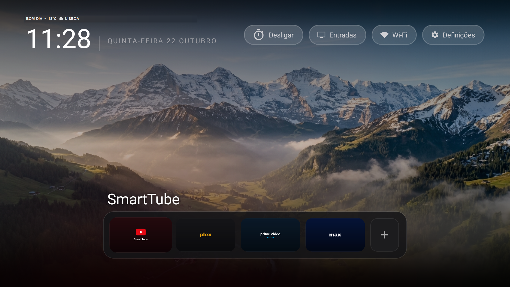
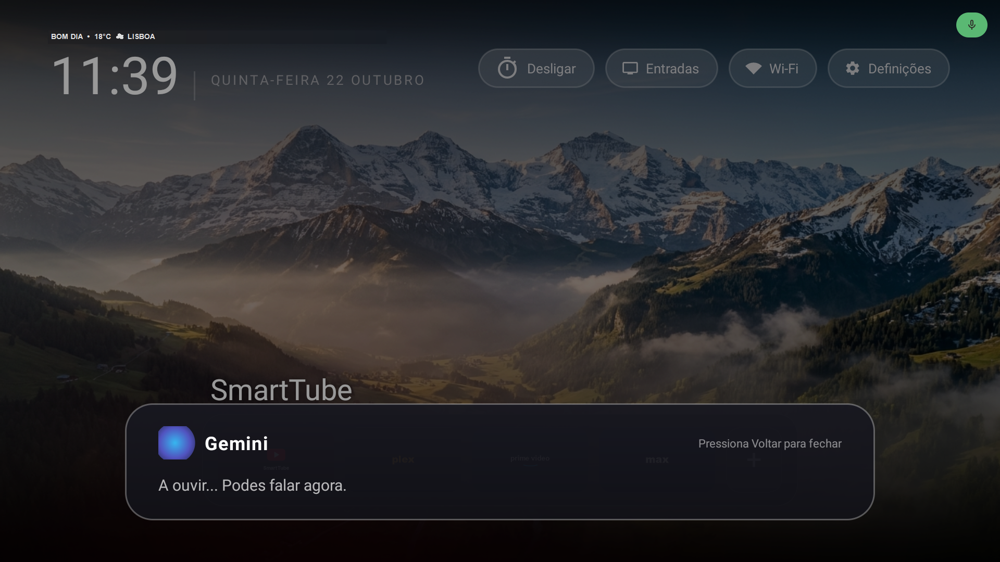
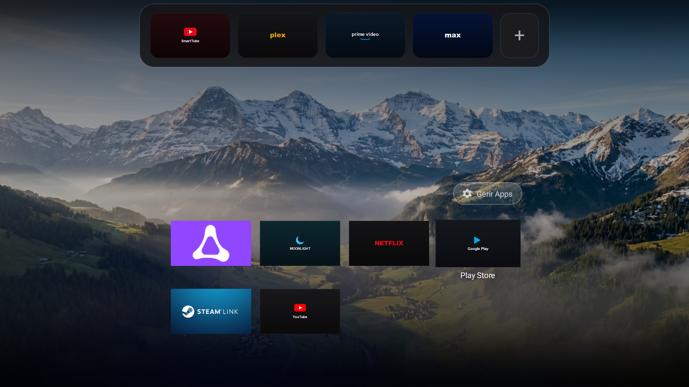
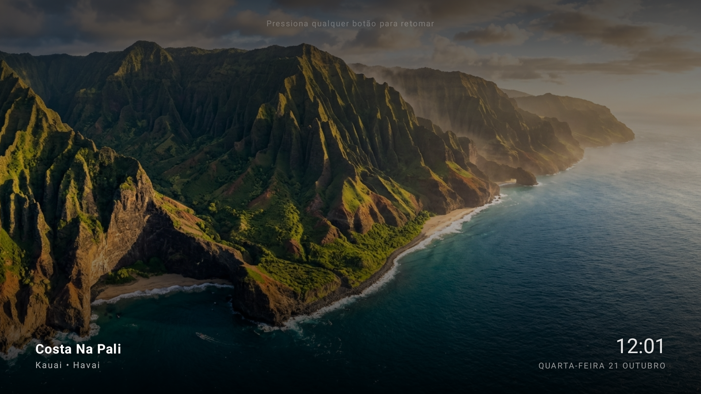

# 🍏 AppleTV-Gemini-AndroidTV

> **A blazing-fast (<40MB RAM), ad-free Apple TV (tvOS) experience for Android TV & Google TV, powered by a native on-device Google Gemini Voice Assistant and zero-latency game controller routing.**

[](https://developer.android.com/tv)
[](LICENSE)
[]()
[](https://aistudio.google.com/)
[]()

---

## 📸 Screenshots (Real TV Running Android 12)

| Home Screen & tvOS Dock | Native Gemini AI Assistant Overlay |
| :---: | :---: |
|  |  |

| Categorized Apps & Cloud Gaming Grid | 4K Apple Aerial Screensaver |
| :---: | :---: |
|  |  |

---

## ⚡ The Problem vs The Solution

| Feature | Stock Google TV / Factory OS | AppleTV-Gemini-AndroidTV |
| :--- | :--- | :--- |
| **RAM Footprint** | ~500MB – 650MB RAM | **< 40MB RAM** (92% reduction) |
| **Ads & Promoted Content** | Full-screen unskippable video ads & trailers | **Zero ads**, pure clean interface |
| **Voice Assistant** | Slow, generic recommendations | **Google Gemini Flash** (Fast conversational TV control) |
| **Screensaver** | Generic Google ambient mode | **Apple TV 4K Aerials** (Ken Burns effect + live clock) |
| **Gaming Controllers** | OEM remote shortcuts hijack gamepads | **Zero-latency bypass** for DualSense 5 / Xbox |
| **Manufacturer Telemetry** | Active tracking & background bloat | **Completely disabled** (Safe debloat) |

---

## ✨ Key Features

1. **Pure tvOS Aesthetics & Fluid Physics:**
   - Translucent floating dock with real-time focus elevation, smooth magnification, and D-pad navigation.
   - Dynamic top bar with Sleep Timer, HDMI Inputs switcher, Wi-Fi status, and Settings.
   - Dynamic real-time weather widget (powered by Open-Meteo, zero API keys required).

2. **Gemini AI Voice Assistant (300ms latency):**
   - Direct remote control microphone button remapping via Android system `ACTION_ASSIST`.
   - Apple Intelligence-style pulsating animated orb in frosted glass card.
   - Structured JSON response actions: launches apps (*Plex, Netflix, SmartTube, Steam Link, Luna*), sets native TV sleep timers (*15, 30, 45, 60 mins*), switches HDMI inputs, changes wallpapers, or answers open general knowledge questions.

3. **Hardware Game Controller Protection:**
   - Dedicated low-level `AccessibilityService` (`RemoteKeyService`) with hardware input filtering.
   - Gamepads (PlayStation DualSense 5, Xbox Wireless Controller, Switch Pro) pass through with **0 ms latency** to Steam Link, Moonlight, or Luna, while preserving physical remote TV shortcut buttons.

4. **Cinematic Apple Aerial Screensavers:**
   - Built on native Android `DreamService` with smooth Ken Burns cinematic panning and 4K aerial photography.
   - Wakes instantly on any remote or gamepad button press.

---

## 🤖 Universal AI Agent Prompt (`PROMPT_BLUEPRINT.md`)

Want to adapt this project to your specific TV model (TCL, Sony, Xiaomi, Philips, Chromecast) using an AI agent (Cursor, Claude Code, Antigravity)?

👉 Check out [PROMPT_BLUEPRINT.md](PROMPT_BLUEPRINT.md) for the complete master prompt that autonomously inspects your hardware over ADB, cleans bloatware, and builds this experience.

---

## 🚀 Quick Installation (Windows 1-Click)

### Prerequisites:
1. Enable **Developer Options** and **USB Debugging** on your TV (*Settings -> System -> About -> Click Build 7 times -> Developer Options -> USB Debugging*).
2. Note your TV's IP address (*Settings -> Network & Internet*).

### Install:
1. Download the latest release from the [Releases](releases/) folder.
2. Run `scripts/install_windows.bat`:
   - Enter your TV's IP address when prompted.
   - The script connects over Wi-Fi, safely debloats background services, installs the launcher, and configures accessibility permissions automatically.

### Restore Stock Google TV:
Changed your mind? Run `scripts/restore_stock_google_tv.bat` anytime to restore the factory launcher and system services.

---

## 🛠️ Building from Source

### Configuration:
1. Open `src/app/src/main/java/com/appletv/launcher/GeminiClient.java`.
2. Add your free Google Gemini API key:
   ```java
   private static final String API_KEY = "YOUR_GEMINI_API_KEY_HERE";
   ```
   *(Get your free key with 1 click at [Google AI Studio](https://aistudio.google.com/))*.

3. (Optional) Customize your weather city in `MainActivity.java`:
   ```java
   prefs.getString("weather_city_name", "YOUR_CITY");
   ```

### Compile with Android SDK:
```bash
cd src/app
# Build with standard Gradle
./gradlew assembleRelease
```

---

## ⚖️ License
Released under the [MIT License](LICENSE).
Apple TV, tvOS, and Apple Intelligence are registered trademarks of Apple Inc. Google Gemini, Android, and Google TV are registered trademarks of Google LLC. This is an independent, non-commercial open-source project.
